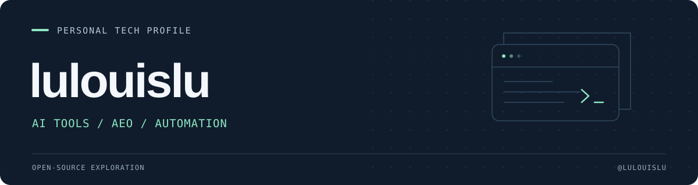

  

## 你好，我是 lulouislu

关注 **AI 工具、AEO 与实用自动化**，从具体问题出发，探索开源工具的用法。

[浏览仓库](https://github.com/lulouislu?tab=repositories) · [我的 Star 清单](https://github.com/lulouislu?tab=stars)

### 关注方向

- **AI 工具与工作流** — AI 辅助编程、工具协作与日常效率。
- **AEO · 答案引擎优化** — 网页内容如何更方便地被 AI 读取和理解。
- **自动化与网络工具** — 信息采集、任务流程与网络规则配置。

### 开源项目导航

精选的 Fork 项目；下方链接同时保留上游来源。

| 项目 | 项目用途 | 上游 |
| :--- | :--- | :--- |
| [dualmark](https://github.com/lulouislu/dualmark) | 通过内容协商，为人类提供 HTML，为 AI 提供 Markdown。 | [dodopayments/dualmark](https://github.com/dodopayments/dualmark) |
| [iptv-api](https://github.com/lulouislu/iptv-api) | 直播源采集、筛选、测速与自动更新。 | [Guovin/iptv-api](https://github.com/Guovin/iptv-api) |
| [ACL4SSR](https://github.com/lulouislu/ACL4SSR) | Clash / ACL 网络分流与过滤规则。 | [langhun/My_ACL_Rules](https://github.com/langhun/My_ACL_Rules) |
